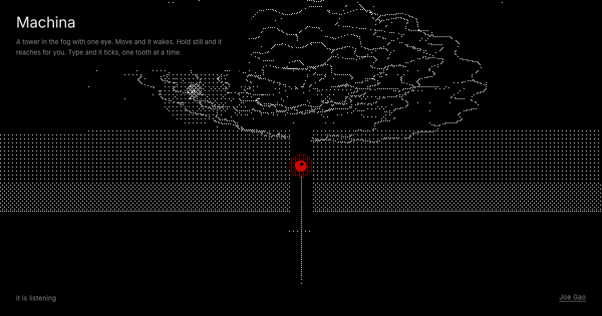

# Machina

A tower in the fog with one red eye. It wakes when you move, reaches for you when you go still, and ticks when you type.

**Live:** https://joezgao.github.io/machina/machina.html



## What it does

The machine pays attention to you, and what changes is its structure, not just its colour:

- **Move**: attention builds; the eye opens out of a closed slit and its pupil follows your cursor (or finger).
- **Hold still** once it has seen you: after about four seconds the gear cloud comes down, flattens and closes around the tower, and the camera drifts in.
- **Type** (or tap): every key turns each gear by exactly one tooth (meshing neighbours turn opposite ways, so the teeth stay engaged) and lights one circuit trace from the tower outward. There is no audio; the ticks are meant to be almost heard.
- **Keep watching**: every 40 seconds with the eye open, the tower grows one more segment, up to six.
- **Leave** (switch tabs, move the pointer out): the eye closes and the cloud lifts back up.

The status line in the corner says which of these it is doing.

## How it is made

One HTML file, three.js 0.180 from a CDN, no build step.

- The scene (fog, a ground plane, a horizon glow, the moon, a stack of dark boxes, seven filled gears placed so each one really meshes with its parent, one right-angle trace from the crown to each gear hub, a haze of points) renders to an offscreen target.
- A fullscreen shader turns it into 1-bit art: luminance against a 4×4 Bayer matrix, in cells of 2 CSS pixels. The eye is pure red in the scene, and the shader keeps red-dominant pixels as the page's single accent (#E5372B), dithered the same way.
- Light mode inverts ink and paper; the eye stays red. `prefers-reduced-motion` slows the drift and turns off the camera moves.

## Credits and boundaries

The theme, a machine that becomes a god and notices you, is old and shared. Nothing here is taken from any particular story or game: no names, characters, scenes or lines.

## Run locally

```
python3 -m http.server
# open http://localhost:8000/machina.html
```

Code MIT, art CC BY-NC 4.0; see [LICENSE](LICENSE).
